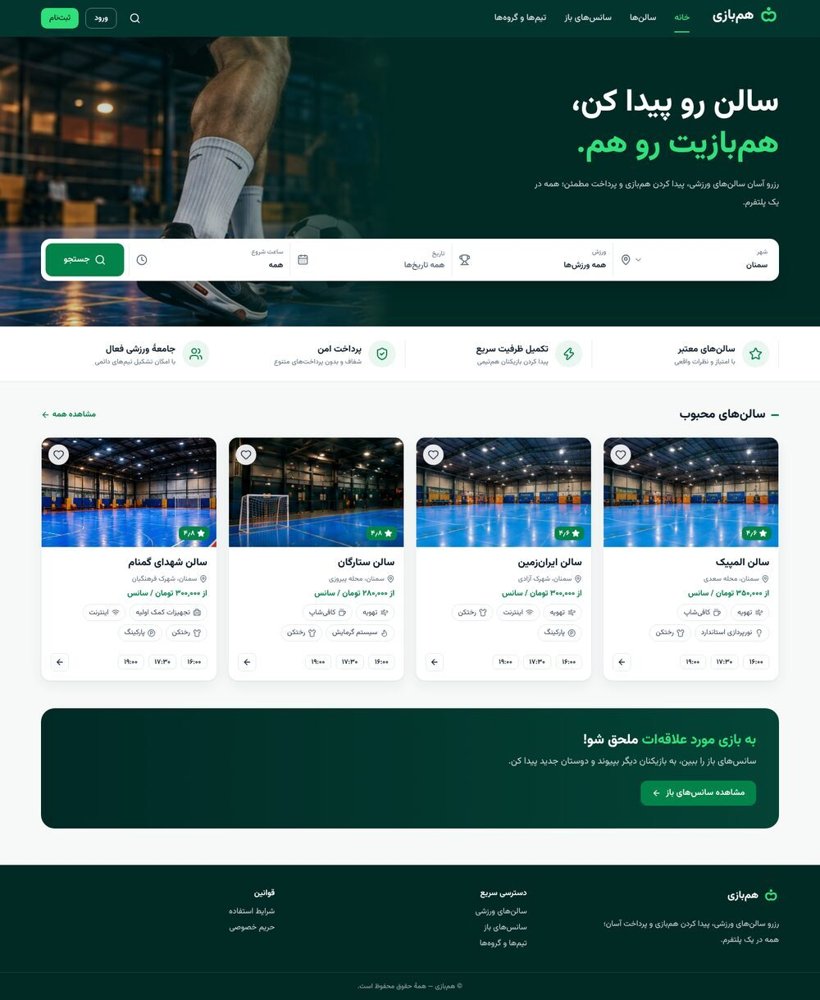
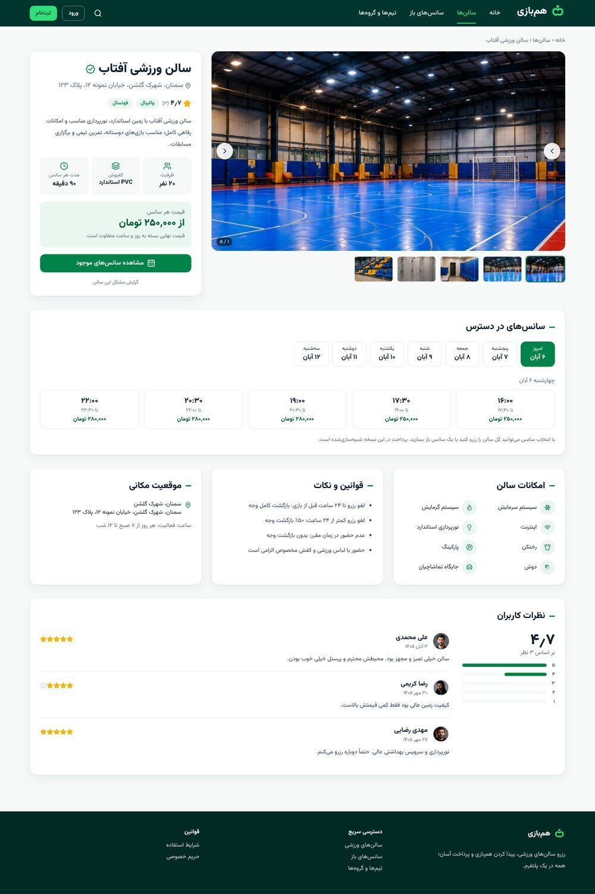
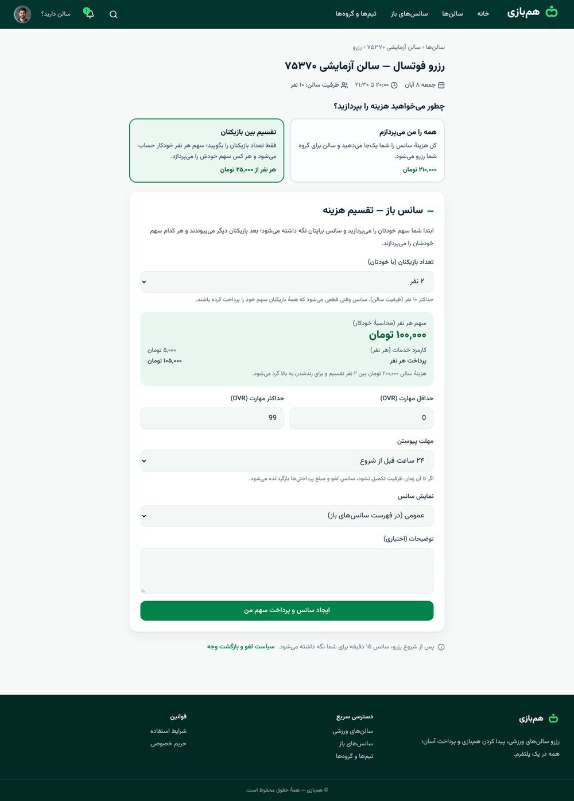
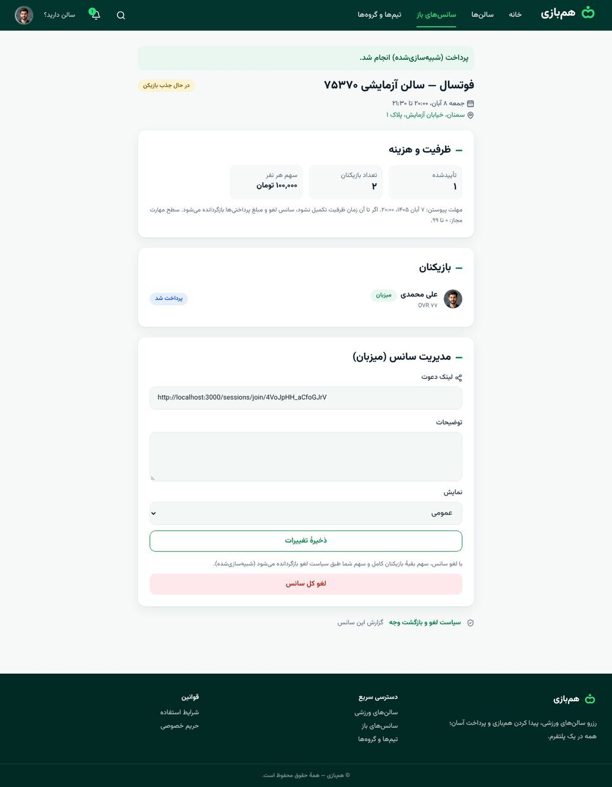
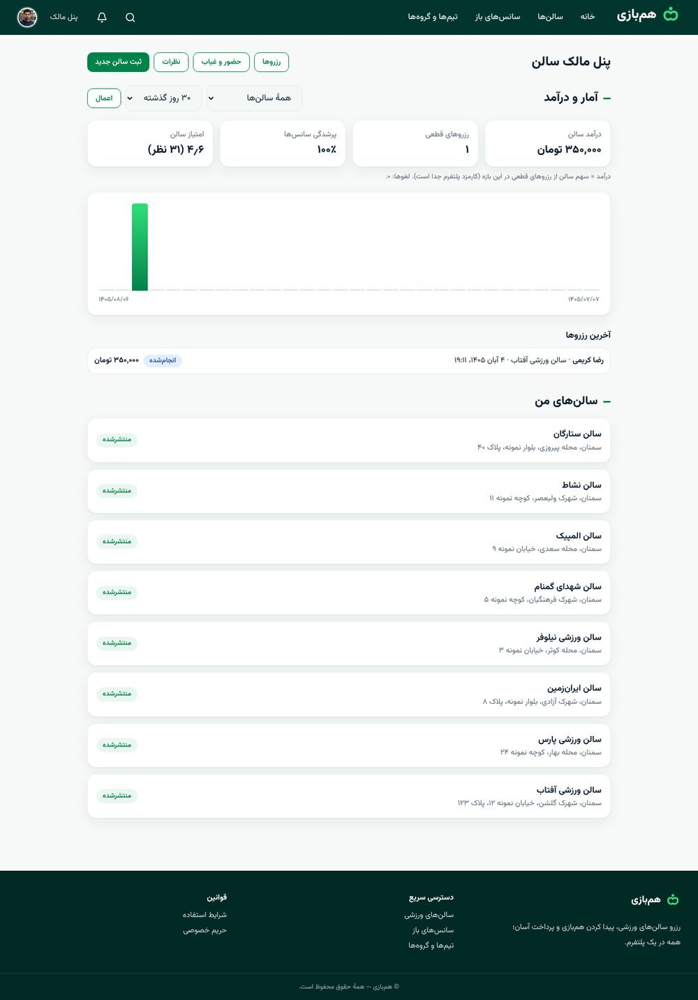
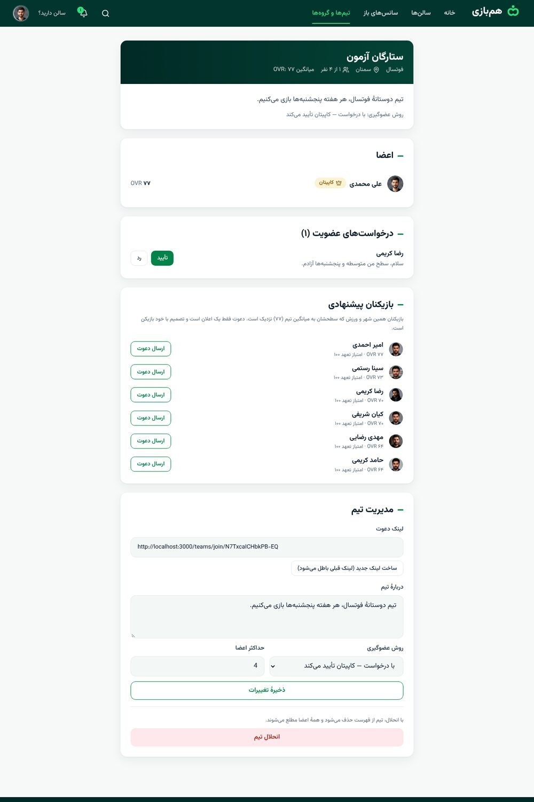
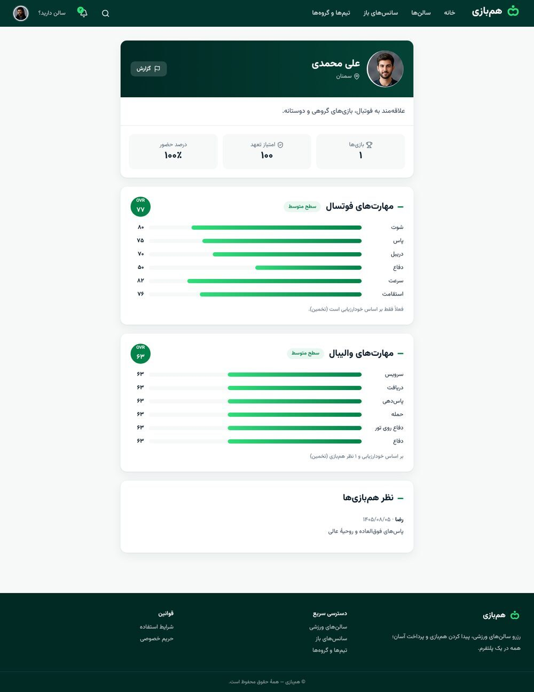
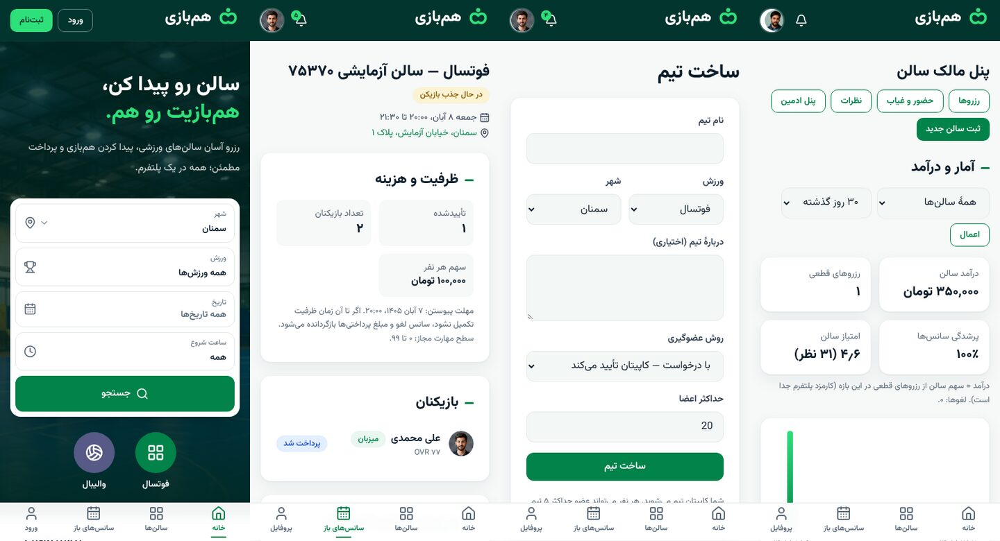

<div align="center">

# HamBazi · هم‌بازی

**Book sports venues, split the bill automatically, and find people to play with.**

A Persian-first (RTL) booking and player-matching platform for futsal and volleyball, built for Iran: Jalali dates, Persian digits, toman, OTP-by-SMS login.


-orange)



</div>

> **Demo status.** Payments are **simulated** and SMS uses a **mock** provider. The server refuses to boot in `production` with either enabled — see [Environment safety](#environment-safety).

## Contents

- [Screenshots](#screenshots)
- [Features](#features)
- [How payment works](#how-payment-works)
- [Tech stack](#tech-stack)
- [Getting started (local)](#getting-started-local)
- [Environment variables](#environment-variables)
- [Scripts](#scripts)
- [Testing](#testing)
- [Deploy: GitHub → Neon → Vercel](#deploy-github--neon--vercel)
- [Architecture notes](#architecture-notes)
- [Project structure](#project-structure)
- [Roadmap](#roadmap)
- [Documentation](#documentation)

## Screenshots

| Venue page | Split payment (auto share) |
|---|---|
|  |  |
| **Open session** | **Owner dashboard** |
|  |  |
| **Teams** | **Player profile (OVR, reliability)** |
|  |  |

<p align="center"></p>

## Features

**Players**
- Passwordless **OTP login**, onboarding with skill self-assessment per sport.
- Browse and filter venues; book a slot with a 15-minute server-side hold.
- **Two ways to pay** — one person pays everything, or the cost is **split automatically** between players ([details](#how-payment-works)).
- **Open sessions**: publish a game, others join and pay their own share; auto-cancel with full (simulated) refunds if the roster isn't complete by the deadline. Invite link for private games.
- **Teams & groups**: create or join teams (public / by request / invite-only), captain tools, invite links, player suggestions matched by city, sport and skill level, and "invite my team" on a session.
- **Trust system**: attendance marked by the venue, a *commitment (reliability) score*, peer skill ratings that blend into an **OVR**, venue reviews (only from people who actually played), reports.
- Notifications with per-group preferences, device/session management.

**Venue owners**
- Venue and slot management with image upload (magic-byte validation, re-encoded to WebP).
- Dashboard: revenue, bookings, occupancy, rating, 7/30/90-day chart, latest reservations.
- Attendance marking and review inbox; cancel a reservation with a full refund.

**Admins**
- Venue approval and suspension, user search and suspension (sessions revoked immediately).
- Platform settings: hold time, join deadline, **versioned** fee and cancellation policy.
- Append-only audit log; report moderation.

**Platform**
- Persian RTL throughout (logical CSS only, enforced by an ESLint rule), Jalali calendar in `Asia/Tehran`, Persian digits, integer-toman money.
- Replaceable brand font in one place (`src/styles/font.css`, see `docs/FONT.md`).

## How payment works

There are two payment modes, chosen on the booking page:

| | **I pay everything** | **Split between players** |
|---|---|---|
| Who pays | The person booking | Every player pays their own share |
| What you enter | Nothing | **Only the number of players** |
| Per-person amount | — | `share = ceil(slot price ÷ players, to the next 1,000 toman)` — computed **on the server** |
| Fee | 5 % of the slot price (min 5,000 toman) | The same rule, charged on each person's share |
| Confirmation | After the single payment | When the roster is full and everyone has paid |
| If the roster isn't full by the deadline | — | Session auto-cancels, everyone is refunded 100 % (simulated) |

Example — a 200,000 toman slot for 7 players: each share is `29,000` toman (+ fee). A price sent from the client is **ignored**; the share is always recomputed server-side (covered by tests). Rounding up guarantees the venue is never underpaid; the small rounding surplus is shown to the user before they commit.

Cancellation refunds follow a **versioned** policy snapshotted on every reservation: ≥ 24 h → 100 %, ≥ 0 h → 50 %, after start → 0 % (venue/system cancellations always refund 100 %). Admins can publish new policy versions without touching old bookings.

## Tech stack

| Area | Choice |
|---|---|
| Framework | Next.js 16 (App Router, Server Actions), React 19, TypeScript (strict) |
| UI | Tailwind CSS 4, lucide-react, Vazirmatn (self-hosted) |
| Database | PostgreSQL 16, Drizzle ORM + drizzle-kit migrations, `postgres.js` (PgBouncer/Neon-safe) |
| Validation | Zod 4 |
| i18n | Central Persian digit/Jalali layer (`jalaali-js`) |
| Storage | Vercel Blob (prod) / local `.uploads/` (dev), `sharp` |
| Tests | Vitest on a real Postgres, Playwright browser E2E |
| Hosting | Vercel + Neon |

## Getting started (local)

Requirements: **Node 22+**, **PostgreSQL 15+** (needs `btree_gist`, included with Postgres).

```bash
git clone <your-repo-url> hambazi && cd hambazi
npm install

# a local database (or use any Postgres you already have)
docker run -d --name hambazi-pg -e POSTGRES_PASSWORD=pass -e POSTGRES_DB=hambazi -p 5432:5432 postgres:16

cp .env.example .env        # then edit DATABASE_URL and the secrets (see below)
npm run db:migrate          # apply migrations
npm run db:seed             # demo data: Semnan venues, slots and sample accounts
npm run dev                 # http://localhost:3000
```

Sign in with a demo phone number; in `development`/`demo` the OTP is shown on screen (mock SMS):

| Phone | Role |
|---|---|
| `09000000001` | Player |
| `09000000002` | Venue manager |
| `09000000003` | Admin |

## Environment variables

Copy `.env.example` to `.env`. Secrets must be ≥ 32 characters (`openssl rand -hex 32`).

| Variable | Purpose |
|---|---|
| `APP_ENV` | `development` \| `demo` \| `production`. Missing or unknown = `production`. |
| `DATABASE_URL` | Postgres URL. On Neon use the **pooled** URL for the app and the **direct** URL for migrations. |
| `OTP_HMAC_SECRET`, `SESSION_SECRET` | Server secrets (hash OTPs, sessions). |
| `CRON_SECRET` | Bearer token for `/api/cron/sweep`. |
| `APP_URL` | Public base URL (used for invite links, secure cookies). |
| `SMS_PROVIDER` | `mock` (dev/demo only). Real provider adapters plug in behind the same interface. |
| `PAYMENT_MODE` | `simulated` (dev/demo only) \| `disabled` \| `sandbox` \| `live`. |
| `BLOB_READ_WRITE_TOKEN` | Vercel Blob token for image uploads (empty locally). |

### Environment safety

`APP_ENV=production` **refuses to start** when `SMS_PROVIDER=mock`, `PAYMENT_MODE=simulated`, or placeholder secrets are configured (validated in `instrumentation.ts`, covered by tests). A demo banner is shown outside production.

## Scripts

| Command | What it does |
|---|---|
| `npm run dev` / `build` / `start` | Develop / build / run the production build |
| `npm run db:migrate` | Apply SQL migrations |
| `npm run db:seed` | Seed demo data (dev/demo only) |
| `npm run db:reset` | Drop and recreate the dev schema |
| `npm run db:generate` | Generate a migration from `src/db/schema.ts` |
| `npm test` | Vitest (needs `hambazi_test`, or set `DATABASE_URL_TEST`) |
| `npm run lint` / `typecheck` | ESLint (incl. the RTL logical-CSS rule) / `tsc --noEmit` |
| `node tests/e2e/phaseN.mjs` | Browser E2E against a running server (`E2E_DB_URL`, `BASE`) |

## Testing

- **Vitest** runs against a real PostgreSQL: concurrent booking and joins, double-booking guard, idempotent payments and refunds, OTP rules, RBAC/IDOR, trust scoring, split-share math, admin policy versioning, teams.
- **Playwright E2E** drives the production build through the real user journeys (login → book → pay → session → attendance → rating → teams → admin), including RTL overflow and Persian-digit checks on mobile and desktop.

```bash
createdb hambazi_test
DATABASE_URL=postgres://localhost:5432/hambazi_test npm run db:migrate
npm test
```

## Deploy: GitHub → Neon → Vercel

1. Push the repo to GitHub (private).
2. Create a **Neon** project; run `npm run db:migrate` (and optionally `db:seed`) with the **direct** connection string.
3. Import the repo in **Vercel**; set the environment variables above (`APP_ENV=demo` for a demo; **never** `simulated`/`mock` with `production`). Use the **pooled** `DATABASE_URL`.
4. Create a **Vercel Blob** store and connect it to the project (adds `BLOB_READ_WRITE_TOKEN`).
5. Set `APP_URL` to the deployed URL and redeploy.

Every later `git push` redeploys automatically; run `npm run db:migrate` first when a release adds a migration. The full step-by-step guide (in Persian) is in [`docs/08-deployment-github-vercel-neon.md`](docs/08-deployment-github-vercel-neon.md).

## Architecture notes

- **No double booking, ever.** Slot row lock (`FOR UPDATE`) plus a partial unique index on active slot claims as the last line of defence; an `EXCLUDE USING gist` constraint prevents overlapping slots per venue and sport.
- **Holds expire lazily and transactionally** on every read/write of the slot; the daily cron is only a backstop (Vercel Hobby allows once a day).
- **Payments are provider-shaped.** Intents are immutable (DB trigger), `payment_events` is append-only, one refund per intent, settlement is idempotent. Swapping the simulator for a real gateway touches one adapter.
- **Money is integer toman** with documented, tested rounding. Fee and cancellation policy are snapshotted on each reservation.
- **Trust data is derived, not stored.** Reliability comes from `reliability_events` (one event per user/reservation/type); OVR blends self-assessment with peer ratings.
- **Authorization at the data layer.** Every owner/admin query is scoped; other owners' data answers `404`, not `403`.
- **RTL correctness.** Logical CSS properties only; an ESLint rule bans `left/right/ml/mr/pl/pr`.

## Project structure

```
src/
  app/            Next.js routes (player, owner, admin, teams, API)
  components/     UI components (booking, owner, layout, forms)
  db/             Drizzle schema, migrations runner, seed
  lib/            i18n (digits, Jalali, phone), labels
  server/
    auth/         OTP, sessions, RBAC
    booking/      holds, reservations, sessions, payments, lifecycle
    owner/        venues, slots, stats
    trust/        attendance, reliability, ratings, reports
    teams/        teams, requests, matching
    admin/        users, policies, settings, audit
    account/      notification prefs, devices
drizzle/          SQL migrations (0000 – 0006)
tests/            Vitest suites + Playwright E2E (tests/e2e)
docs/             Design, architecture, deployment, phase handoffs
```

## Roadmap

| Phase | Scope | Status |
|---|---|---|
| 0 | Architecture, data model, design system | ✅ |
| 1 | OTP login, venue discovery, profiles | ✅ |
| 2 | Booking core, open sessions, simulated payments, owner panel | ✅ |
| 3 | Attendance, reliability score, ratings, reports | ✅ |
| 4 | Owner dashboard, user settings, admin panel | ✅ |
| 5 | Automatic split payment UX, teams & matching, English README | ✅ |
| 6 | Text chat rooms (sessions & teams) | ✅ |
| 7 | Chat replies & identity colours, favourites, waiting list, support desk, admin oversight, venue staff | ✅ |
| 7 | Real payment gateway (sandbox → live) | ⏳ |
| 8 | PWA (installable, offline fallback), accessibility pass | ✅ |
| 9 | Release hardening | ⏳ |

## Documentation

Detailed design and handoff documents live in [`docs/`](docs/00-README.md) (written in Persian). Start with the [index](docs/00-README.md); the latest handoff is [`docs/15-phase8-handoff.md`](docs/15-phase8-handoff.md).

## License

Proprietary — all rights reserved. (Choose a license before making the repository public.)
