<div align="center">

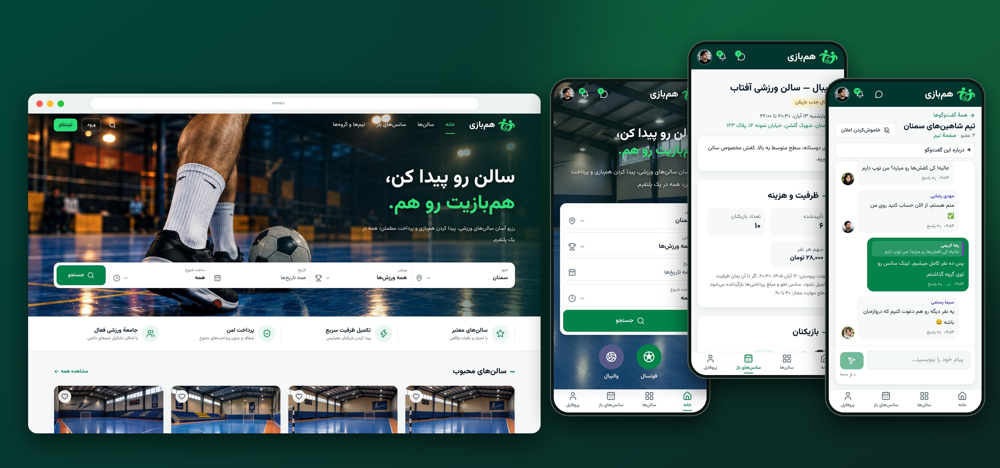

# HamBazi · هم‌بازی

### Book a court. Split the bill. Find your team.

A **Persian-first (RTL)** booking and player-matching platform for **futsal** and **volleyball**, built for Iran —
Jalali dates, Persian digits, integer toman, and OTP-by-SMS login.


-orange)

</div>

> **Demo status.** Payments are **simulated** and SMS uses a **mock** provider by default. The server **refuses to boot** in `production` with either enabled — see [Environment safety](#environment-safety). A real SMS adapter (Kavenegar) is included.

---

## Why HamBazi?

Organising a weekly game usually means a group chat, a phone call to the venue, and one person fronting the money. HamBazi turns that into three taps:

| 🏟️ Find & book | 💸 Split automatically | 🤝 Play with the right people |
|---|---|---|
| Browse venues, see real availability, and hold a slot for 15 minutes on the server. | Enter *only the number of players*; the server computes each share and charges everyone separately. | Open sessions, teams, skill-matched suggestions, reliability scores and an in-app chat. |

## Contents

- [Screenshots](#screenshots)
- [Install as an app](#install-as-an-app)
- [Features](#features)
- [How payment works](#how-payment-works)
- [Architecture](#architecture)
- [Security & reliability](#security--reliability)
- [Tech stack](#tech-stack)
- [Getting started](#getting-started)
- [Environment variables](#environment-variables)
- [Scripts](#scripts)
- [Testing](#testing)
- [Deploy: GitHub → Neon → Vercel](#deploy-github--neon--vercel)
- [Run it on your own machine (no Vercel)](#run-it-on-your-own-machine-no-vercel)
- [Project structure](#project-structure)
- [Roadmap](#roadmap)
- [Documentation](#documentation)

## Screenshots

> Captured at 2× resolution from the production build with seeded demo data (all names, venues and numbers are fictional).

### Discover and book

<table>
<tr>
<td width="50%">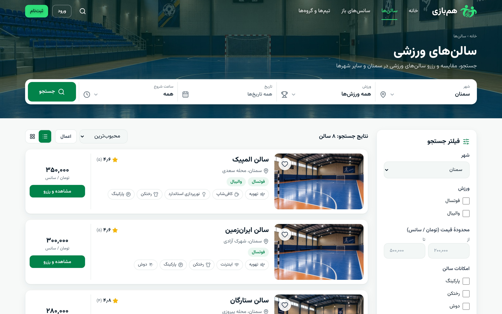<br><sub><b>Search & filter</b> — city, sport, Jalali date, start hour, price, facilities.</sub></td>
<td width="50%">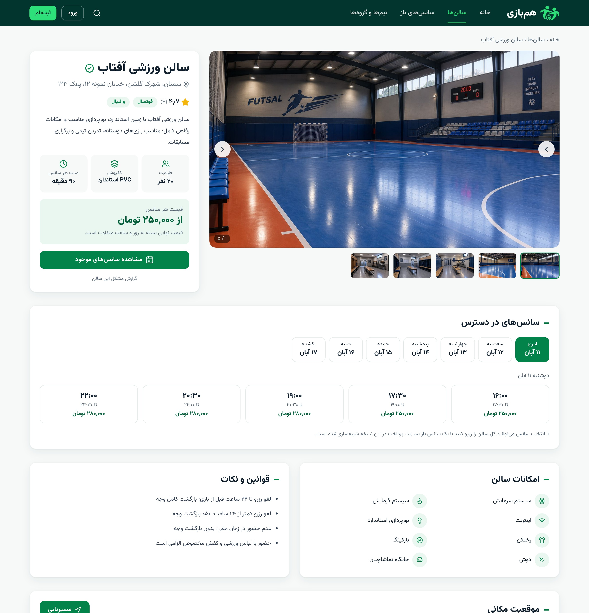<br><sub><b>Venue page</b> — gallery, facilities, live slots, map and one-tap navigation.</sub></td>
</tr>
<tr>
<td width="50%">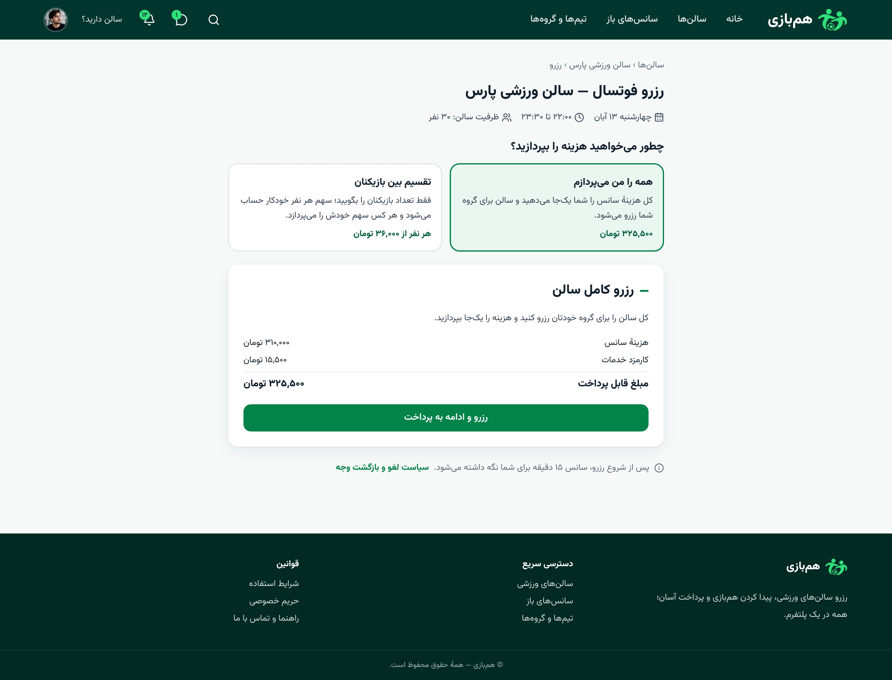<br><sub><b>Two payment modes</b> — pay everything, or split between players.</sub></td>
<td width="50%">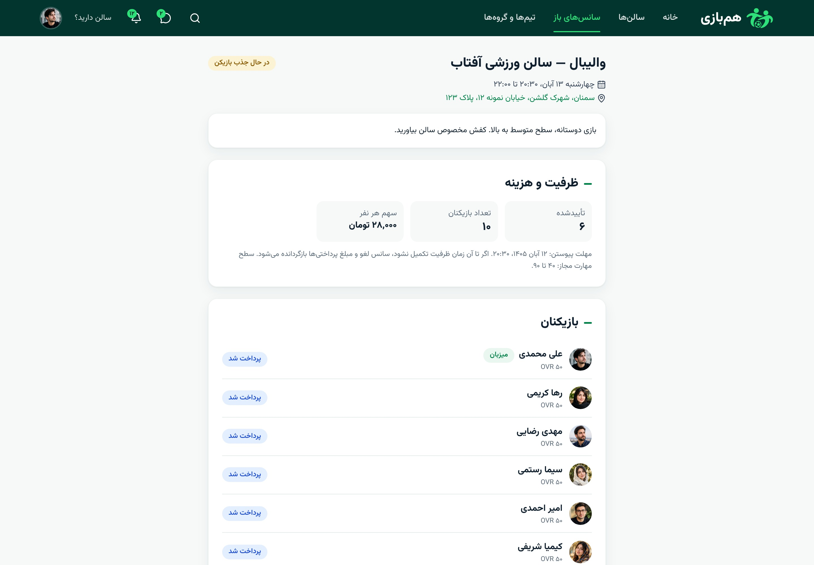<br><sub><b>Open session</b> — roster, per-person share, invite link, host tools.</sub></td>
</tr>
</table>

### Play together

<table>
<tr>
<td width="50%">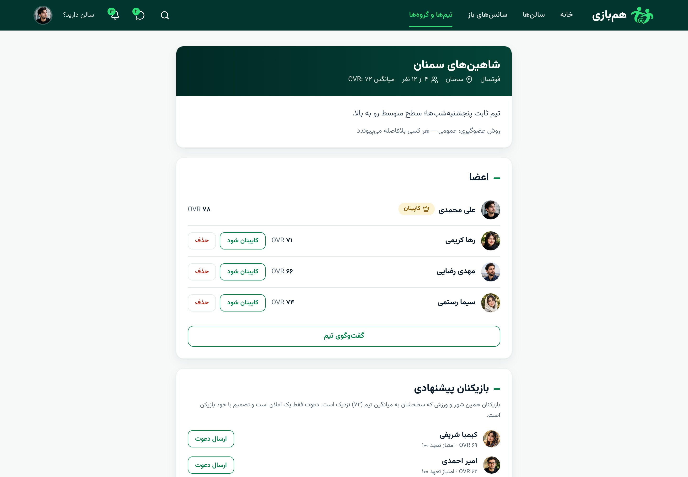<br><sub><b>Teams</b> — captain tools, invite links and skill-matched player suggestions.</sub></td>
<td width="50%">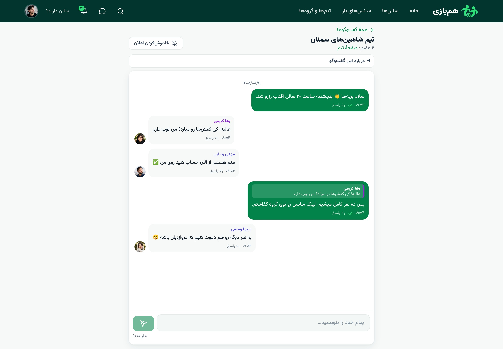<br><sub><b>Chat</b> — replies, edit/delete, read ticks, per-person colours.</sub></td>
</tr>
<tr>
<td width="50%">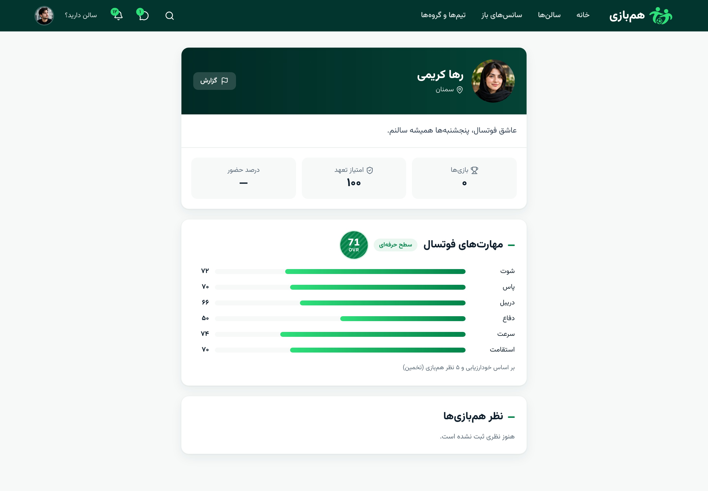<br><sub><b>Player profile</b> — OVR, per-skill bars, reliability and peer reviews.</sub></td>
<td width="50%">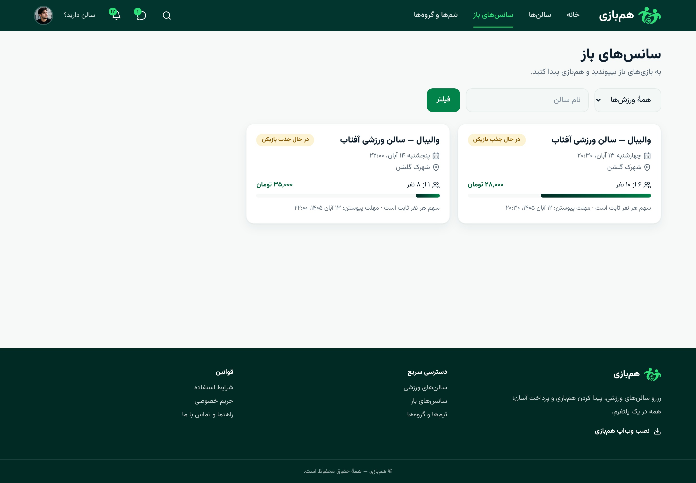<br><sub><b>Open sessions</b> — browse, filter and join; each player pays their own share.</sub></td>
</tr>
</table>

### Run a venue

<table>
<tr>
<td width="50%">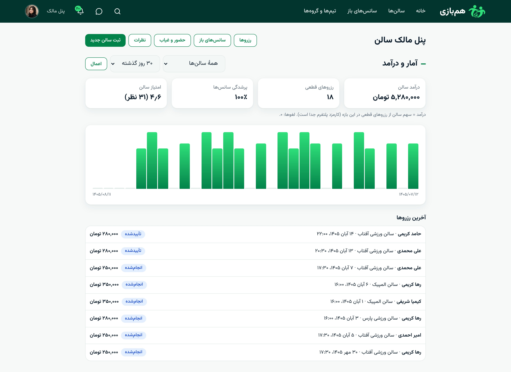<br><sub><b>Owner dashboard</b> — revenue, bookings, occupancy, rating and a 7/30/90-day chart.</sub></td>
<td width="50%">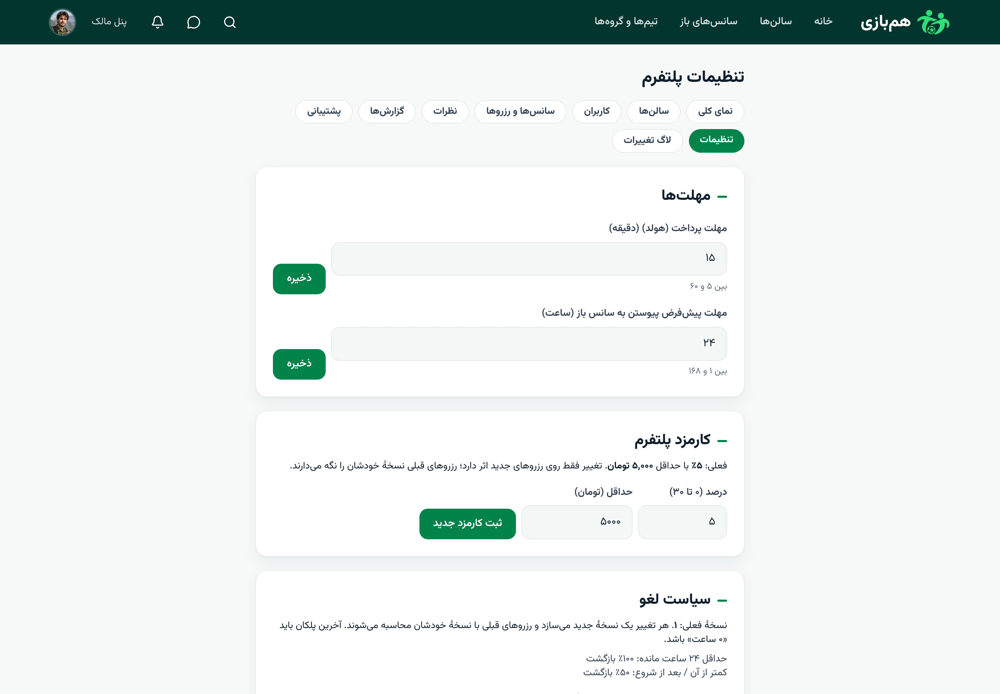<br><sub><b>Admin</b> — venue approval, versioned fee & cancellation policy, audit log.</sub></td>
</tr>
</table>

### Mobile first

<p align="center">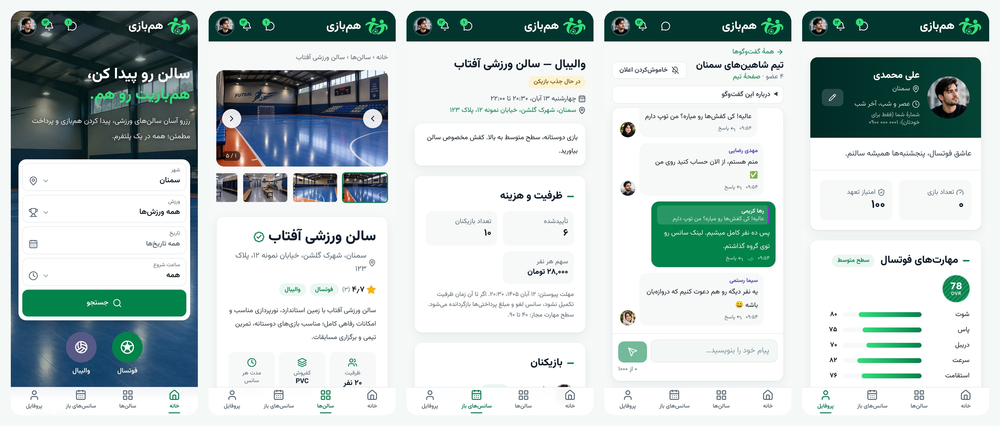</p>

## Install as an app

Visitors who open HamBazi in a normal browser get a popup right away offering to install the web app — **one click** on Chromium (Android, desktop Chrome/Edge), or the three "Add to Home Screen" steps on iOS Safari. The popup has a **"don't show again"** checkbox; closing it any other way hides it for the rest of the session. A permanent **"Install the web app"** entry stays in the footer for every browser visitor, and nothing is shown once the app is installed or running standalone.

<p align="center">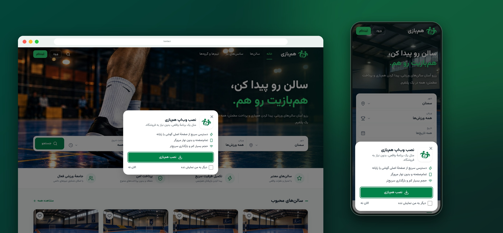</p>

## Features

**Players**
- Passwordless **OTP login** and onboarding with per-sport skill self-assessment; multi-select preferred play times.
- Browse and filter venues; book a slot with a 15-minute server-side hold (at most 3 unpaid holds per user).
- **Two ways to pay** — one person pays, or the cost is **split automatically** ([details](#how-payment-works)).
- **Open sessions**: publish a game, others join and pay their share; auto-cancel with full (simulated) refunds if the roster isn't complete by the deadline; private invite links; waiting list for full games.
- **Teams & groups**: public / by-request / invite-only, captain tools, invite links, suggestions by city, sport and skill, "invite my team" to a session.
- **Chat** for sessions and teams: replies, edit (48 h) and delete-for-everyone, read ticks, unread badges, 90-day retention.
- **Trust system**: attendance marked by the venue, a *commitment score*, peer skill ratings blended into **OVR**, venue reviews (only from people who played), reports.
- Favourites, notifications with preferences, device/session management, support desk.
- **One-click install** of the web app (popup + footer entry).
- **Map and navigation** on every venue; on Android the phone's own "open with" app chooser (Neshan, Balad, Google Maps, Waze…).

**Venue owners & staff**
- Venue and slot management, image upload (magic-byte checks, re-encoded to WebP), map location picker.
- Dashboard: revenue, bookings, occupancy, rating and chart; attendance marking; review inbox; staff accounts with limited rights.

**Admins**
- Venue approval/suspension, user search/suspension (sessions revoked immediately), review moderation, support desk.
- Platform settings with **versioned** fee and cancellation policy; append-only audit log.

**Platform**
- Persian RTL throughout (logical CSS only — enforced by an ESLint rule), Jalali calendar in `Asia/Tehran`, Persian digits, integer-toman money.
- **Installable PWA** with an offline page; the service worker caches static assets only, never pages or API responses.
- Accessibility: axe-core pass on 12 pages with no serious or critical violations.
- SEO basics: `robots.txt`, `sitemap.xml`, Open Graph tags; `/api/health` for uptime probes.

## How payment works

| | **I pay everything** | **Split between players** |
|---|---|---|
| Who pays | The person booking | Every player pays their own share |
| What you enter | Nothing | **Only the number of players** |
| Per-person amount | — | `share = ceil(slot price ÷ players, to the next 1,000 toman)` — computed **on the server** |
| Fee | 5 % of the slot price (min 5,000 toman) | The same rule, charged on each person's share |
| Confirmation | After the single payment | When the roster is full and everyone has paid |
| If the roster isn't full by the deadline | — | Session auto-cancels, everyone is refunded 100 % (simulated) |

Example — a 200,000 toman slot for 7 players: each share is `29,000` toman (+ fee). A price sent from the client is **ignored**; the share is always recomputed server-side (covered by tests). Rounding up guarantees the venue is never underpaid, and the small surplus is shown to the user before they commit.

Cancellation refunds follow a **versioned** policy snapshotted on every reservation: ≥ 24 h → 100 %, ≥ 0 h → 50 %, after the game starts → no cancellation. Venue and system cancellations always refund 100 %. Admins can publish new policy versions without touching old bookings.

## Architecture

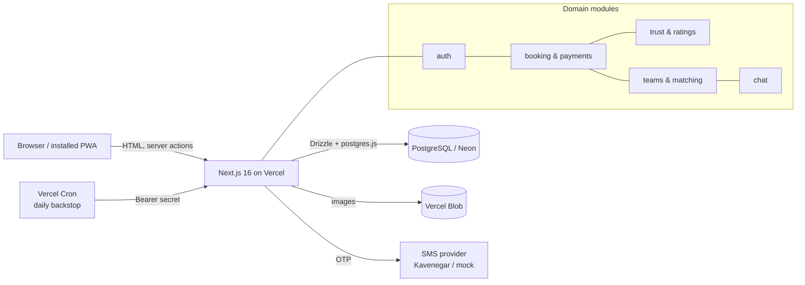

- **No double booking, ever.** Slot row lock (`FOR UPDATE`) plus a partial unique index on active slot claims as the last line of defence; an `EXCLUDE USING gist` constraint prevents overlapping slots per venue and sport.
- **Holds expire lazily and transactionally** on every read/write; the daily cron is only a backstop.
- **Payments are provider-shaped.** Intents are immutable (DB trigger), `payment_events` is append-only, one refund per intent, settlement is idempotent. Swapping the simulator for a real gateway touches one adapter.
- **Money is integer toman** with documented, tested rounding. Fee and cancellation policy are snapshotted on every reservation.
- **Trust data is derived, not stored.** Reliability comes from `reliability_events`; OVR blends self-assessment with peer ratings.
- **Authorization at the data layer.** Every owner/admin query is scoped; other people's data answers `404`, not `403`. Chat membership is derived at read time.
- **RTL correctness.** Logical CSS properties only; an ESLint rule bans `left/right/ml/mr/pl/pr`.

## Security & reliability

| Area | What is in place |
|---|---|
| Authentication | OTP hashed with HMAC, attempt and resend limits, per-IP and per-phone rate limits, sessions stored as SHA-256 hashes, rotation on login, instant revocation on suspension |
| Authorization | Role checks in every server action, resource-level checks (host / captain / venue manager), 404 for foreign resources, safe `?next=` redirects |
| Input | Zod validation, UUID guards on ids, bounded hours/dates, parameterised SQL only, uploads sniffed and re-encoded |
| Money | Row locks, unique-index backstops, idempotent settlement, one refund per intent, no cancellation after the game starts |
| Abuse | Rate limits on login, chat and invites; cap on simultaneous unpaid holds |
| Headers | Strict CSP, HSTS, `X-Frame-Options: DENY`, `nosniff`, restricted permissions policy |
| Config | Unsafe production configurations (mock SMS, simulated payments, placeholder secrets, missing provider keys) stop the server from starting |

The phase-9 review and its findings are written up in [`docs/18-phase9-handoff.md`](docs/18-phase9-handoff.md).

## Tech stack

| Area | Choice |
|---|---|
| Framework | Next.js 16 (App Router, Server Actions), React 19, TypeScript (strict) |
| UI | Tailwind CSS 4, lucide-react, Vazirmatn (self-hosted), Leaflet + OpenStreetMap |
| Database | PostgreSQL 16, Drizzle ORM + drizzle-kit migrations, `postgres.js` (PgBouncer/Neon-safe) |
| Validation | Zod 4 |
| i18n | Central Persian digit/Jalali layer (`jalaali-js`) |
| Storage | Vercel Blob (prod) / local `.uploads/` (dev), `sharp` |
| SMS | Kavenegar (`verify/lookup`) or mock for development |
| Tests | Vitest on a real Postgres, Playwright browser E2E, axe-core |
| Hosting | Vercel + Neon |

## Getting started

Requirements: **Node 22+**, **PostgreSQL 15+** (needs `btree_gist`, included with Postgres).

```bash
git clone <your-repo-url> hambazi && cd hambazi
npm install

# a local database (or use any Postgres you already have)
docker run -d --name hambazi-pg -e POSTGRES_PASSWORD=pass -e POSTGRES_DB=hambazi -p 5432:5432 postgres:16

cp .env.example .env        # then edit DATABASE_URL and the secrets (see below)
npm run db:migrate          # apply migrations
npm run db:seed             # demo data: Semnan venues, slots and sample accounts
npm run dev                 # http://localhost:3000
```

Sign in with a demo phone number; in `development`/`demo` the OTP is shown on screen (mock SMS):

| Phone | Role |
|---|---|
| `09000000001` | Player |
| `09000000002` | Venue manager |
| `09000000003` | Admin |

## Environment variables

Copy `.env.example` to `.env`. Secrets must be ≥ 32 characters (`openssl rand -hex 32`).

| Variable | Purpose |
|---|---|
| `APP_ENV` | `development` \| `demo` \| `production`. Missing or unknown = `production`. |
| `DATABASE_URL` | Postgres URL. On Neon use the **pooled** URL for the app and the **direct** URL for migrations. |
| `OTP_HMAC_SECRET`, `SESSION_SECRET` | Server secrets (hash OTPs, sessions). |
| `CRON_SECRET` | Bearer token for `/api/cron/sweep`. |
| `APP_URL` | Public base URL (invite links, secure cookies, sitemap, Open Graph). |
| `SMS_PROVIDER` | `mock` (dev/demo only) or `kavenegar`. |
| `SMS_API_KEY`, `SMS_TEMPLATE` | Kavenegar API key and the name of a `verify/lookup` template containing `%token`. |
| `PAYMENT_MODE` | `simulated` (dev/demo only) \| `disabled` \| `sandbox` \| `live`. |
| `BLOB_READ_WRITE_TOKEN` | Vercel Blob token for image uploads (empty locally). |

### Environment safety

`APP_ENV=production` **refuses to start** when `SMS_PROVIDER=mock`, `PAYMENT_MODE=simulated`, placeholder secrets, an unknown SMS provider, or Kavenegar without key/template are configured (validated in `instrumentation.ts`, covered by tests). A demo banner is shown outside production.

## Scripts

| Command | What it does |
|---|---|
| `npm run dev` / `build` / `start` | Develop / build / run the production build |
| `npm run db:migrate` | Apply SQL migrations |
| `npm run db:seed` | Seed demo data (dev/demo only) |
| `npm run db:reset` | Drop and recreate the dev schema |
| `npm run db:generate` | Generate a migration from `src/db/schema.ts` |
| `npm test` | Vitest (needs `hambazi_test`, or set `DATABASE_URL_TEST`) |
| `npm run lint` / `typecheck` | ESLint (incl. the RTL logical-CSS rule) / `tsc --noEmit` |
| `node tests/e2e/phaseN.mjs` | Browser E2E against a running production server (`E2E_DB_URL`, `BASE`) |

## Testing

- **Vitest — 205 tests** on a real PostgreSQL: concurrent booking and joins, double-booking guard, idempotent payments and refunds, OTP rules, RBAC/IDOR, trust scoring, split-share math, policy versioning, teams, chat membership/edit/delete, geo helpers, play-time parsing, SMS adapter (with a mocked `fetch`), environment safety.
- **Playwright E2E** drives the production build through real journeys (login → book → pay → session → attendance → rating → teams → chat → admin) plus RTL overflow, Persian-digit, alignment, PWA, SEO and axe checks on mobile and desktop.

```bash
createdb hambazi_test
DATABASE_URL=postgres://localhost:5432/hambazi_test npm run db:migrate
npm test
```

## Deploy: GitHub → Neon → Vercel

1. Push the repo to GitHub (private).
2. Create a **Neon** project; run `npm run db:migrate` (and optionally `db:seed`) with the **direct** connection string.
3. Import the repo in **Vercel**; set the environment variables above (`APP_ENV=demo` for a demo; **never** `simulated`/`mock` with `production`). Use the **pooled** `DATABASE_URL`.
4. Create a **Vercel Blob** store and connect it to the project (adds `BLOB_READ_WRITE_TOKEN`).
5. Set `APP_URL` to the deployed URL and redeploy.

Every later `git push` redeploys automatically; run `npm run db:migrate` first when a release adds a migration. The full step-by-step guide (in Persian) is in [`docs/08-deployment-github-vercel-neon.md`](docs/08-deployment-github-vercel-neon.md).

## Run it on your own machine (no Vercel)

```bash
npm run build
npx next start -H 0.0.0.0 -p 3000
```

- **Android over USB (PWA installs):** `adb reverse tcp:3000 tcp:3000`, then open `http://localhost:3000` in Chrome and set `APP_URL=http://localhost:3000`.
- **Wi-Fi:** set `APP_URL=http://<your-LAN-IP>:3000` and open that address on the phone (login works; PWA install and the service worker need HTTPS).
- **HTTPS from anywhere:** put a tunnel (for example Cloudflare Tunnel or Tailscale) in front and use its HTTPS URL as `APP_URL`.

## Project structure

```
src/
  app/            Next.js routes (player, owner, admin, teams, chat, API, robots, sitemap)
  components/     UI components (booking, chat, owner, layout, forms, venues)
  db/             Drizzle schema, migrations runner, seed
  lib/            i18n (digits, Jalali, phone), labels, geo, play times
  server/
    auth/         OTP, sessions, RBAC
    booking/      holds, reservations, sessions, payments, lifecycle
    owner/        venues, slots, staff, stats
    trust/        attendance, reliability, ratings, reports
    teams/        teams, requests, matching
    messaging/    chat rooms, messages, edit/delete, retention
    admin/        users, policies, settings, audit, oversight
    providers/    SMS adapters (Kavenegar, mock)
drizzle/          SQL migrations (0000 – 0010)
tests/            Vitest suites + Playwright E2E (tests/e2e)
docs/             Design, architecture, deployment, phase handoffs
```

## Roadmap

| Phase | Scope | Status |
|---|---|---|
| 0 | Architecture, data model, design system | ✅ |
| 1 | OTP login, venue discovery, profiles | ✅ |
| 2 | Booking core, open sessions, simulated payments, owner panel | ✅ |
| 3 | Attendance, reliability score, ratings, reports | ✅ |
| 4 | Owner dashboard, user settings, admin panel | ✅ |
| 5 | Automatic split payment UX, teams & matching | ✅ |
| 6 | Text chat rooms (sessions & teams) | ✅ |
| 7 | Replies, favourites, waiting list, support desk, venue staff | ✅ |
| 8 | PWA, accessibility, messenger-style chat, map & navigation, polish | ✅ |
| 9 | Hardening, Kavenegar SMS, SEO, health check, clean-up | ✅ |
| 10 | Install-the-app popup and footer entry, sample-data polish | ✅ |
| 11 | Real payment gateway (sandbox → live) | ⏳ |

## Documentation

Detailed design and handoff documents live in [`docs/`](docs/00-README.md) (written in Persian). Start with the [index](docs/00-README.md); the latest handoff is [`docs/19-phase10-handoff.md`](docs/19-phase10-handoff.md).

## License

Proprietary — all rights reserved. (Choose a license before making the repository public.)
