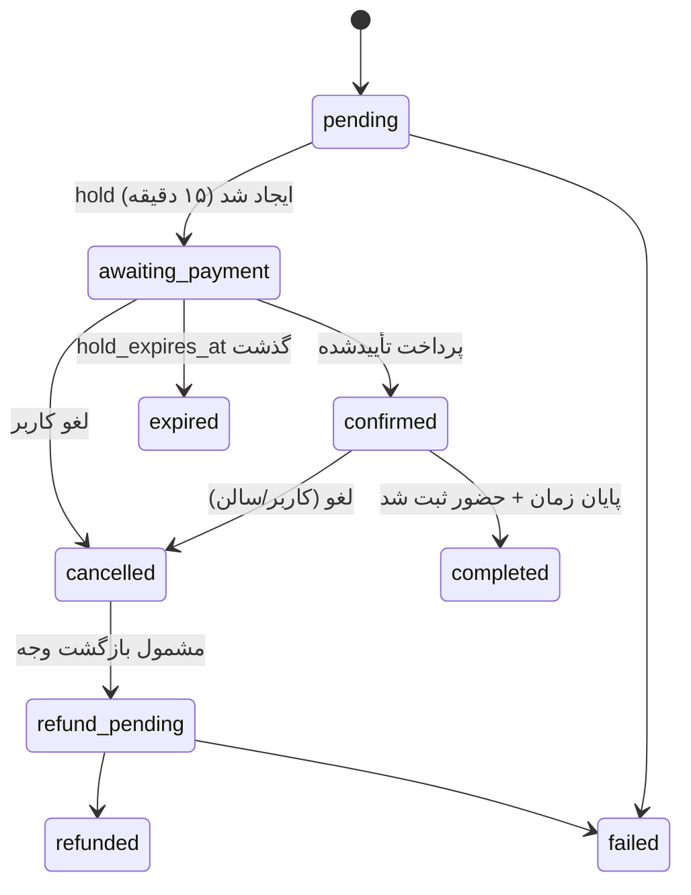
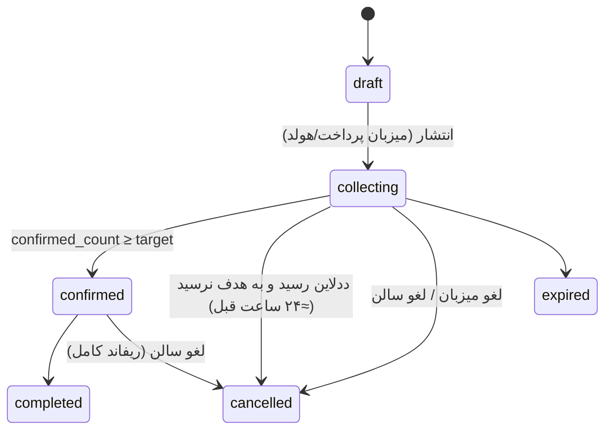

# ۰۴ — ماشین‌های حالت

گذارها فقط در سرویس مربوطه و داخل تراکنش انجام می‌شوند؛ هر گذار ثبت می‌شود و رد گذار نامعتبر خطا می‌دهد.

## رزرو (Reservation) + هولد

هولد: `slot_claims.status held → confirmed | released`. ارزیابی انقضا در هر خواندن/نوشتن همان اسلات (تراکنشی)؛ cron فقط پشتیبان.

## سانس باز (OpenSession)

## شرکت‌کنندهٔ سانس (SessionParticipant)
`pending_payment → confirmed → attended | no_show` ، `pending_payment → expired`، `confirmed → left` (طبق سیاست لغو پلکانی)، `* → removed` (فقط میزبان/ادمین با ثبت audit). گذار به `confirmed` فقط با پرداخت تأییدشده یا حالت `single` که میزبان کل مبلغ را پرداخته.

## پرداخت (PaymentIntent)
`created → requires_action → succeeded | failed | cancelled` ؛ `succeeded → refund_pending → refunded` (نه تغییر در مبلغ اصلی). `mode` ثابت. تکرار callback با همان `idempotency_key` = بدون اثر.

## بازگشت وجه (Refund)
`requested → processing → succeeded | failed`؛ simulated فقط رکورد وضعیت است. unique `(intent_id, reason)` جلوی دوباره‌کاری را می‌گیرد.

## سیاست لغو اولیه (پیکربندی‌شونده، نسخه‌دار)
| رویداد | نتیجه |
|---|---|
| سالن لغو کند | بازگشت ۱۰۰٪ |
| سانس به هدف نرسد تا ددلاین | لغو خودکار + بازگشت ۱۰۰٪ |
| بازیکن > ۲۴ ساعت قبل لغو کند | بازگشت ۱۰۰٪ (طبق متن UI مرجع) |
| بازیکن < ۲۴ ساعت لغو کند | ۵۰٪ (مقدار پیش‌فرض؛ قابل‌تنظیم)؛ اگر جایگزین جذب شد → ۱۰۰٪ |
| غیبت | بدون بازگشت + جریمهٔ تعهد |
